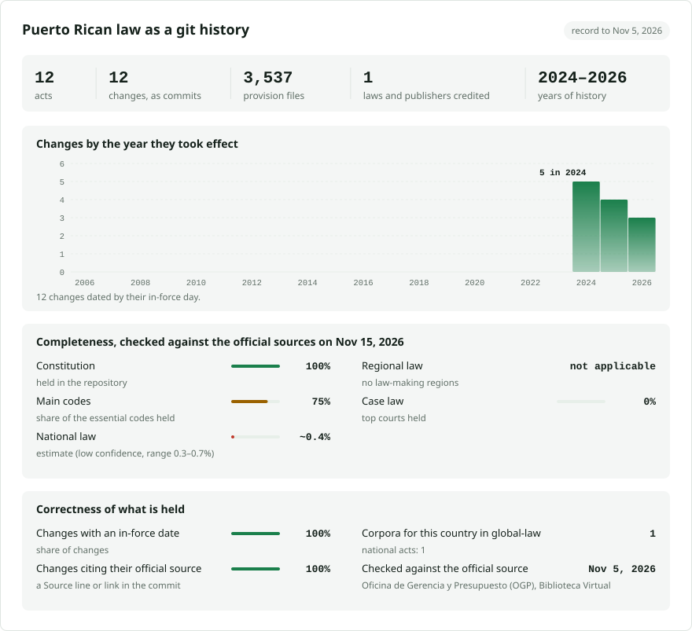

# Puerto Rico: law history in git

[Español](README.md) · **English**

<picture>
<source media="(prefers-color-scheme: dark)" srcset="data/effort-dark.svg">

</picture>

The law of Puerto Rico as a git history: one file per article, section or rule, one commit per version on the day it took effect, and the source of each version as the commit's author: the law that made the change where it is known, otherwise the publisher. `git blame` names the version behind every line; `git log` lists every change to a provision; picking a date gives the text in force that day.

Part of [lexifina/global-law](https://github.com/lexifina/global-law), one git history for every country's law: this is Puerto Rico's law, which global-law reads at `puerto-rico/national/acts/`.

**What is in it now:** the Constitution and 11 codes, laws and rules, 3,525 provisions in all, each in one version, the Oficina de Gerencia y Presupuesto's current compilation (revised between 2024 and 2026): the Código Civil de 2020, the Código Penal, the Reglas de Procedimiento Criminal, the Reglas de Evidencia, the Ley de Transacciones Comerciales, the Ley General de Corporaciones, three labour laws (Ley 80-1976 on unjust dismissal, Ley 379-1948 on working hours and Ley 4-2017), the Ley de Procedimiento Administrativo Uniforme (Ley 38-2017) and the Ley de Transparencia (Ley 141-2019). [`data/versions.json`](data/versions.json) lists every act with its version, its day and the copy it was read from.

Each act is a folder named after it, with one file per provision and a `README.md` that lists them (`ley-80-1976-despidos/art-0001.md` is Artículo 1 of the Ley sobre Despidos Injustificados, Ley 80-1976; `constitucion/art-02-sec-07.md` is Article II, Section 7 of the Constitution).

The text is in Spanish, as the OGP compiles it. An English translation is not part of this record.

## Questions as git commands

| Question | Command |
| --- | --- |
| Every change to Article 1 of Ley 80-1976 | `git log -p --word-diff -- ley-80-1976-despidos/art-0001.md` |
| Which version wrote each line of Article 1? | `git blame ley-80-1976-despidos/art-0001.md` |
| Every version of Ley 80-1976, with the day each took effect | `git log --format="%h %(trailers:key=In-force,valueonly,separator=) %an" -- ley-80-1976-despidos ":^*README.md"` |
| Article 1 as in force on 1 January 2025 | `python tools/on.py 2025-01-01 ley-80-1976-despidos 1` |

**Outside git**, we also host this record publicly, for free:

- **[Ask Claude about Puerto Rico law](https://global-law.lexifina.com/v1/try_claude?country=puerto-rico)**: opens Claude with a first question ready.
- **[Ask ChatGPT](https://global-law.lexifina.com/v1/try_chatgpt?country=puerto-rico)**: the same question in ChatGPT.
- **[Search Puerto Rico law on our site](https://lexifina.com/law?country=puerto-rico&q=vacaciones)**: a search for "vacaciones", with each provision's text and its versions, no account needed.
- **[Developer REST API](https://global-law.lexifina.com/v1/search_law?query=vacaciones&jurisdiction=puerto-rico)**: the same search as JSON, with no key. See the [documentation here](https://lexifina.com/api/global-law).

Both assistants read the record through the free Global law connector (MCP, `https://global-law.lexifina.com/mcp`); the first time, the chat gives you the link that adds it. Ask in Spanish or in English.

**Host it yourself easily.** All it takes is git and Python, and the tools run on your machine:

```sh
git clone --depth 1 https://github.com/lexifina/global-law && cd global-law
python3 tools/countries.py add puerto-rico/national/acts
python3 tools/law.py show 2026-01-01 puerto-rico/national/acts/ley-80-1976-despidos/art-0001.md
```

Opened in Claude Code, Cursor, VS Code or Codex, the clone also starts a local MCP server with the same tools ([MCP.md](https://github.com/lexifina/global-law/blob/main/MCP.md)).

## Dates

Each commit is dated at noon, America/Puerto_Rico, on the day in its `In-force:` trailer:

- for ten acts, the Constitution among them, the revision date the OGP prints on its compilation ("Rev. 15 de abril de 2024"), as the compilation gives no day its text took effect;
- for Ley 38-2017 and Ley 141-2019, the day their latest incorporated amendment took effect: Ley 16-2025 on 14 May 2025 and Ley 156-2025 on 13 December 2025, each in force on its approval.

Each act's one version is its "oldest version available", credited to the publisher, `Oficina de Gerencia y Presupuesto (OGP), Biblioteca Virtual`, not to the laws that amended it; the committer is Lexifina.

## How it is checked

- `tools/check_repo.py` reads every version back from git on the day it took effect and on the day before, and compares it with the corpus, whose sha256 is in `data/corpus.sha256`: 12 versions of 12 acts, 0 mismatches ([`REPRODUCE.md`](REPRODUCE.md)).
- The words are the OGP's own, from the PDFs' text layer: page headers and footers are removed, wrapped lines joined and the OGP's bracketed amendment notes left out; nothing else in the words is changed.
- History is append-only (`tools/append.py`): no merge commits, commit dates never go backwards, nothing is dated in the future, and every commit's trailers parse.
- [vulnerabilities/](vulnerabilities/README.en.md): possible drafting mistakes in this law, found by global-law's detectors and checked by hand. Not run yet.

## What it does not show

- **Earlier versions.** Each act is here only as the OGP compiles it now; the amendments before that are inside its one commit and are not credited to the laws that made them. The OGP keeps no past compilations, and the Constitution, in force since 25 July 1952 and amended since, has no dated earlier texts online.
- **Most Puerto Rico law.** Other laws, regulations and case law are not here; the annotated code (L.P.R.A.) is a commercial publication. The Código de Comercio de 1932 is left out: the OGP publishes no text-layer copy of it.
- **Headings and preambles.** Expositions of motives, tables of contents and most chapter and title headings are left out; the Constitution keeps its Preamble and article headings, and Ley 38-2017 its chapter headings.
- **United States federal law**, which also applies in Puerto Rico.

## Sources

| Source | Kind | Past versions | Notes |
| --- | --- | --- | --- |
| [Biblioteca Virtual](https://bvirtualogp.pr.gov/ogp/Bvirtual/) (Oficina de Gerencia y Presupuesto) | Compilations of the Constitution, codes, laws and rules "según enmendada", and the amending laws | no, current text only | Text-layer PDFs, each with its revision date. The OGP says they are not official and may contain inadvertent errors. Ley 80-1976, 379-1948 and 4-2017 are compiled without Ley 41-2022, which the Title III court annulled on 3 March 2023 |

## Licence

See [`LICENSE`](LICENSE). The OGP states no licence for its compilations; the attribution is "Source: Oficina de Gerencia y Presupuesto, Gobierno de Puerto Rico." Lexifina's tooling and documentation in this repository are under the MIT licence.

No AI model wrote, translated or corrected legal text, and none runs at build time; the scripts were written by Claude Code running Claude Opus 5.5 (see [`REPRODUCE.md`](REPRODUCE.md)).

## Visualisations

- [visualisations/](visualisations/README.en.md): charts drawn from this repository. Not drawn yet.

## More

From [lexifina/global-law](https://github.com/lexifina/global-law):

- [FEATURES.md](https://github.com/lexifina/global-law/blob/main/FEATURES.md): every feature, and what every corpus must support (`git blame`, `law.py`, the MCP tools)
- [FAQ.md](https://github.com/lexifina/global-law/blob/main/FAQ.md): questions and answers · [CONTRIBUTING.md](https://github.com/lexifina/global-law/blob/main/CONTRIBUTING.md): proposing changes · [MCP.md](https://github.com/lexifina/global-law/blob/main/MCP.md): the MCP server · [REPRODUCE.md](https://github.com/lexifina/global-law/blob/main/REPRODUCE.md): how it was built · [CHANGELOG.md](https://github.com/lexifina/global-law/blob/main/CHANGELOG.md)
- [FRESHNESS.md](https://github.com/lexifina/global-law/blob/main/FRESHNESS.md): how current each corpus is · [Monitoring](https://github.com/lexifina/global-law/tree/main/monitoring): whether updates are running · [WATCHING.md](https://github.com/lexifina/global-law/blob/main/WATCHING.md): how each official source is watched for changes
- [performance/](https://github.com/lexifina/global-law/tree/main/performance): how fast the tools are, measured
- [visualisations/](https://github.com/lexifina/global-law/tree/main/visualisations): charts and bridges across the world's law
- [Vulnerabilities](https://github.com/lexifina/global-law/tree/main/vulnerabilities): mistakes in legislation as published
