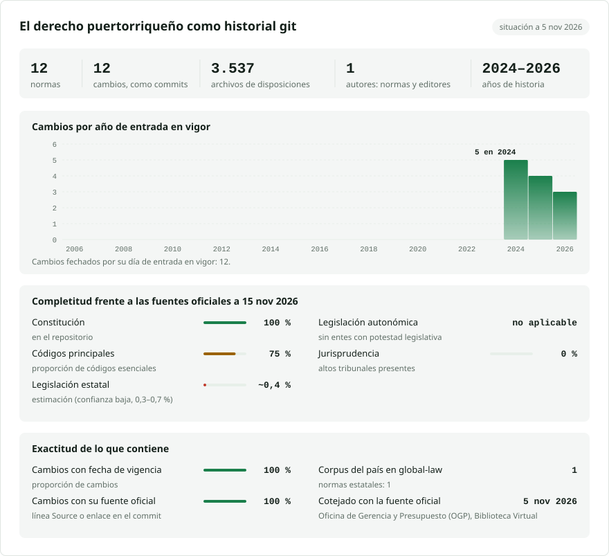

# Puerto Rico: historia del derecho en git

**Español** · [English](README.en.md)

<picture>
<source media="(prefers-color-scheme: dark)" srcset="data/es/effort-dark.svg">

</picture>

El derecho de Puerto Rico como historial de git: un archivo por artículo, sección o regla, un commit por versión, fechado el día de su entrada en vigor, y la fuente de cada versión como autora del commit: la ley que hizo el cambio cuando se conoce y, si no, el editor. `git blame` nombra la versión de cada línea; `git log` enumera cada cambio de una disposición; al elegir una fecha se obtiene el texto vigente ese día.

Forma parte de [lexifina/global-law](https://github.com/lexifina/global-law), un único historial de git para el derecho de todos los países: este es el derecho de Puerto Rico, que global-law lee en `puerto-rico/national/acts/`.

**Qué contiene ahora:** la Constitución y 11 códigos, leyes y reglas, 3,525 disposiciones en total, cada una en una versión, la compilación vigente de la Oficina de Gerencia y Presupuesto (revisada entre 2024 y 2026): el Código Civil de 2020, el Código Penal, las Reglas de Procedimiento Criminal, las Reglas de Evidencia, la Ley de Transacciones Comerciales, la Ley General de Corporaciones, tres leyes laborales (la Ley 80-1976, sobre despidos injustificados, la Ley 379-1948, sobre la jornada de trabajo, y la Ley 4-2017), la Ley de Procedimiento Administrativo Uniforme (Ley 38-2017) y la Ley de Transparencia (Ley 141-2019). [`data/versions.json`](data/versions.json) enumera cada norma con su versión, su día y la copia de la que se leyó.

Cada norma es una carpeta con su nombre, con un archivo por disposición y un `README.md` que las enumera (`ley-80-1976-despidos/art-0001.md` es el Artículo 1 de la Ley sobre Despidos Injustificados, Ley 80-1976; `constitucion/art-02-sec-07.md` es el Artículo II, Sección 7 de la Constitución).

El texto está en español, tal como lo compila la OGP. Una traducción al inglés no forma parte de este registro.

## Preguntas como comandos de git

| Pregunta | Comando |
| --- | --- |
| Cada cambio del Artículo 1 de la Ley 80-1976 | `git log -p --word-diff -- ley-80-1976-despidos/art-0001.md` |
| ¿Qué versión escribió cada línea del Artículo 1? | `git blame ley-80-1976-despidos/art-0001.md` |
| Cada versión de la Ley 80-1976, con el día en que entró en vigor cada una | `git log --format="%h %(trailers:key=In-force,valueonly,separator=) %an" -- ley-80-1976-despidos ":^*README.md"` |
| El Artículo 1 vigente el 1 de enero de 2025 | `python tools/on.py 2025-01-01 ley-80-1976-despidos 1` |

**Fuera de git**, también alojamos este registro de forma pública y gratuita:

- **[Pregunte a Claude sobre el derecho de Puerto Rico](https://global-law.lexifina.com/v1/try_claude?country=puerto-rico)**: abre Claude con una primera pregunta ya preparada.
- **[Pregunte a ChatGPT](https://global-law.lexifina.com/v1/try_chatgpt?country=puerto-rico)**: la misma pregunta en ChatGPT.
- **[Busque en el derecho de Puerto Rico en nuestro sitio](https://lexifina.com/law?country=puerto-rico&q=vacaciones)**: una búsqueda de "vacaciones", con el texto de cada disposición y sus versiones, sin necesidad de cuenta.
- **[API REST para desarrolladores](https://global-law.lexifina.com/v1/search_law?query=vacaciones&jurisdiction=puerto-rico)**: la misma búsqueda en JSON, sin clave. Consulte la [documentación aquí](https://lexifina.com/api/global-law).

Ambos asistentes leen el registro mediante el conector gratuito Global law (MCP, `https://global-law.lexifina.com/mcp`); la primera vez, el chat le da el enlace para añadirlo. Pregunte en español o en inglés.

**Alójelo usted mismo fácilmente.** Solo hacen falta git y Python, y las herramientas se ejecutan en su propio equipo:

```sh
git clone --depth 1 https://github.com/lexifina/global-law && cd global-law
python3 tools/countries.py add puerto-rico/national/acts
python3 tools/law.py show 2026-01-01 puerto-rico/national/acts/ley-80-1976-despidos/art-0001.md
```

Abierto en Claude Code, Cursor, VS Code o Codex, el clon también inicia un servidor MCP local con las mismas herramientas ([MCP.md](https://github.com/lexifina/global-law/blob/main/MCP.md)).

## Fechas

Cada commit está fechado al mediodía, hora de America/Puerto_Rico, del día que indica su trailer `In-force:`:

- para diez normas, entre ellas la Constitución, la fecha de revisión que la OGP imprime en su compilación ("Rev. 15 de abril de 2024"), ya que la compilación no da ningún día de entrada en vigor de su texto;
- para la Ley 38-2017 y la Ley 141-2019, el día en que entró en vigor su enmienda incorporada más reciente: la Ley 16-2025, el 14 de mayo de 2025, y la Ley 156-2025, el 13 de diciembre de 2025, cada una vigente desde su aprobación.

La única versión de cada norma es su "oldest version available" (la versión más antigua disponible), atribuida al editor, `Oficina de Gerencia y Presupuesto (OGP), Biblioteca Virtual`, no a las leyes que la enmendaron; el committer es Lexifina.

## Cómo se comprueba

- `tools/check_repo.py` vuelve a leer desde git cada versión el día en que entró en vigor y el día anterior, y la compara con el corpus, cuyo sha256 está en `data/corpus.sha256`: 12 versiones de 12 normas, 0 discrepancias ([`REPRODUCE.md`](REPRODUCE.md)).
- Las palabras son las de la propia OGP, tomadas de la capa de texto de los PDF: se eliminan los encabezados y pies de página, se unen las líneas cortadas y se omiten las notas de enmienda entre corchetes de la OGP; no se cambia nada más en las palabras.
- El historial solo crece por adición (`tools/append.py`): no hay commits de fusión (merge), las fechas de commit nunca retroceden, nada lleva una fecha futura y los trailers de todos los commits se pueden analizar.
- [vulnerabilities/](vulnerabilities/): posibles errores de redacción en este derecho, hallados por los detectores de global-law y revisados a mano. Aún no se ha ejecutado.

## Lo que no muestra

- **Las versiones anteriores.** Cada norma está aquí solo tal como la compila hoy la OGP; las enmiendas anteriores quedan dentro de su único commit y no se atribuyen a las leyes que las hicieron. La OGP no conserva compilaciones pasadas, y la Constitución, vigente desde el 25 de julio de 1952 y enmendada desde entonces, no tiene en línea textos anteriores fechados.
- **La mayor parte del derecho de Puerto Rico.** Las demás leyes, los reglamentos y la jurisprudencia no están aquí; el código anotado (L.P.R.A.) es una publicación comercial. Se deja fuera el Código de Comercio de 1932: la OGP no publica ninguna copia suya con capa de texto.
- **Los encabezados y los preámbulos.** Se omiten las exposiciones de motivos, los índices y la mayoría de los encabezados de capítulo y de título; la Constitución conserva su Preámbulo y los encabezados de sus artículos, y la Ley 38-2017 sus encabezados de capítulo.
- **El derecho federal de los Estados Unidos**, que también se aplica en Puerto Rico.

## Fuentes

| Fuente | Tipo | Versiones anteriores | Notas |
| --- | --- | --- | --- |
| [Biblioteca Virtual](https://bvirtualogp.pr.gov/ogp/Bvirtual/) (Oficina de Gerencia y Presupuesto) | Compilaciones de la Constitución, de códigos, leyes y reglas "según enmendada", y las leyes enmendatorias | no, solo el texto vigente | PDF con capa de texto, cada uno con su fecha de revisión. La OGP advierte que no son oficiales y que pueden contener errores involuntarios. Las Leyes 80-1976, 379-1948 y 4-2017 se compilan sin la Ley 41-2022, que el tribunal del Título III anuló el 3 de marzo de 2023 |

## Licencia

Véase [`LICENSE`](LICENSE). La OGP no indica ninguna licencia para sus compilaciones; la atribución es "Source: Oficina de Gerencia y Presupuesto, Gobierno de Puerto Rico." Las herramientas y la documentación de Lexifina en este repositorio están bajo la licencia MIT.

Ningún modelo de IA escribió, tradujo ni corrigió texto jurídico, y ninguno se ejecuta al construir el historial; los scripts los escribió Claude Code con Claude Opus 5.5 (véase [`REPRODUCE.md`](REPRODUCE.md)).

Esta es una traducción de la versión inglesa ([README.en.md](README.en.md)); si difieren, prevalece la versión inglesa.

## Visualizaciones

- [visualisations/](visualisations/): gráficos hechos a partir de este repositorio. Aún no se han hecho.

## Más información

Del repositorio [lexifina/global-law](https://github.com/lexifina/global-law) (páginas en inglés):

- [FEATURES.md](https://github.com/lexifina/global-law/blob/main/FEATURES.md): todas las funciones y lo que cada corpus debe admitir (`git blame`, `law.py`, herramientas MCP)
- [FAQ.md](https://github.com/lexifina/global-law/blob/main/FAQ.md): preguntas y respuestas · [CONTRIBUTING.md](https://github.com/lexifina/global-law/blob/main/CONTRIBUTING.md): proponer cambios · [MCP.md](https://github.com/lexifina/global-law/blob/main/MCP.md): servidor MCP · [REPRODUCE.md](https://github.com/lexifina/global-law/blob/main/REPRODUCE.md): cómo se ha construido · [CHANGELOG.md](https://github.com/lexifina/global-law/blob/main/CHANGELOG.md)
- [FRESHNESS.md](https://github.com/lexifina/global-law/blob/main/FRESHNESS.md): lo actualizado que está cada corpus · [Supervisión](https://github.com/lexifina/global-law/tree/main/monitoring): si las actualizaciones funcionan · [WATCHING.md](https://github.com/lexifina/global-law/blob/main/WATCHING.md): cómo se vigila cada fuente oficial para detectar cambios
- [performance/](https://github.com/lexifina/global-law/tree/main/performance): la rapidez de las herramientas, medida
- [visualisations/](https://github.com/lexifina/global-law/tree/main/visualisations): gráficos y conexiones a través del derecho de todo el mundo
- [Vulnerabilidades](https://github.com/lexifina/global-law/tree/main/vulnerabilities): errores en las normas tal como se publicaron
